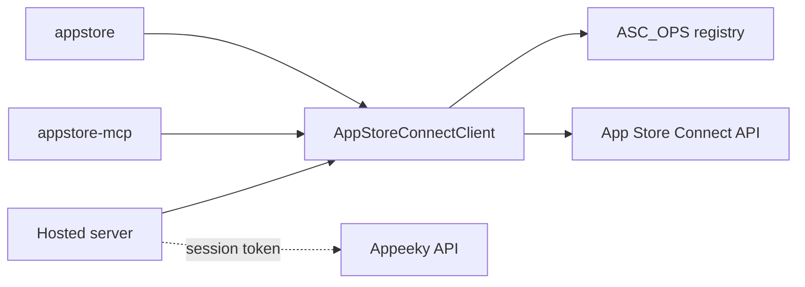

## Components

```
packages/
  core/     # AppStoreConnectClient, resources, ASC_OPS, generated OpenAPI types
  cli/      # appstore (published, bundles core + mcp)
  mcp/      # appstore-mcp (stdio)
  server/   # hosted MCP + REST on Appeeky sessions
```



## Design

1. Every App Store Connect call goes through `AppStoreConnectClient` in `@appeeky/app-store-connect-core`: signing, retries, pagination, read-only checks and error formatting live in one place.
2. Request bodies are typed against Apple's OpenAPI spec (`pnpm generate:types`), so a renamed attribute shows up as a compile error.
3. Operations are registered once in `ASC_OPS`. MCP tools, `appstore ops call` and the hosted REST API are generated from it.
4. CLI subcommands are thin wrappers over the registry for common workflows.

## Extending

1. Add a method to the resource class in `packages/core/src/resources`.
2. Register an `AscOp` in `packages/core/src/ops/<group>.ts`.
3. Optionally add a CLI subcommand.
4. Run `pnpm build && pnpm docs:ops` to refresh the [operations reference](/reference/operations).

See [Contributing](/contributing).
