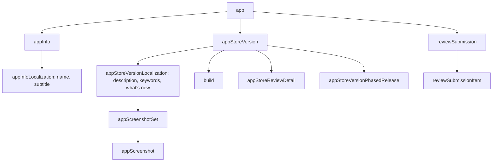

App Store Connect is a JSON:API: every object has a `type` and an opaque `id`, and objects point at each other through relationships. Most commands take the id of the object they change, so it helps to know the chain.

| You want to change | You need | Find it with |
|--------------------|----------|--------------|
| App name, subtitle | app info localization id | `apps infos`, then `apps localizations <appInfoId>` |
| Description, keywords, what's new | version localization id | `versions list`, then `versions localizations <versionId>` |
| Screenshots | screenshot set id | `screenshots sets <versionLocalizationId>` |
| Attach a build | version id + build id | `versions list`, `builds list` |
| Phased release | version id (the CLI looks up the phased release id) | `versions list` |

## App ids

The app id is Apple's numeric id (the one in the App Store URL). Wherever the CLI takes `--app`, you can pass a bundle id instead; it is resolved with `GET /v1/apps?filter[bundleId]=…`. MCP tools and the REST API take the numeric `appId`; agents can call `appstore_find_app` first.

## Platforms

Versions, submissions and builds are per platform: `IOS`, `MAC_OS`, `TV_OS`, `VISION_OS`. Bundle IDs and devices use `IOS`, `MAC_OS` or `UNIVERSAL`.

## Pagination

List endpoints return up to `limit` items (Apple's maximum is usually 200) plus `links.next`. Pass `all: true` (CLI `--all`) to follow every page; the result then has `data`, `included` and `meta.total`.
